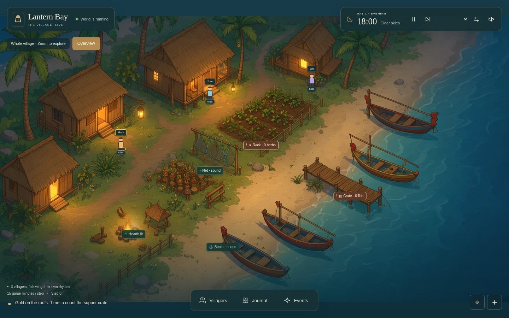

# Lantern Bay · Village Sim

A small, autonomous 2D fishing village. Villagers work toward daily goals, make
friends, talk and remember while lanterns flicker beside the water. Runs locally
with **Python 3.11+**, a modern browser, and **no dependencies or API key**.



## Run

From the project directory:

```bash
python3 -m village_sim
```

Open **http://127.0.0.1:8000**. The village runs while the server is open, including
when no browser is connected. Stop it with Ctrl+C. All viewers share one session.

```bash
python3 -m village_sim --port 8080 --agents 5 --interval 1 --seed 42
```

The viewer works on desktop and phone. Pause, advance a single step, adjust speed,
choose 1–8 villagers in settings, or introduce a passing storm or lantern festival.
Select a villager on the map or a card to inspect their persona, daily goals,
friendships, daily plan and session memories. Goal progress and familiar faces
appear in **Story**; select a friend to take a closer look at them.

The village fills the browser window with floating playback and map controls.
Open **Villagers**, **Journal** or **Events** from the dock when you want more
detail; close a panel or press Escape to return to the unobstructed village.
Selecting a villager opens their details and centers the map on them. Drag,
scroll or swipe to explore the enlarged canvas, use **Overview** to see the whole
village, and toggle labels or zoom with the map controls. The page stays in place
while panels scroll independently.

The village shares a pantry: fish, herbs, net and boat condition, and a hearth
that lights after dark. Work produces specific successes or failures. Supper at
dusk spends the supplies, remembers a shortfall, and shapes tomorrow’s goals.
Storms damage the net and close the jetty; festivals spend supplies and welcome
a visitor to the guest cottage. Relationships keep the latest shared promise or
grudge. In Hybrid mode, kept and missed meetings also move a private trust score,
and a villager who has seen someone break plans will ask a more reliable person
for help. At midnight, a two-sentence village reflection is pinned above the compact chore
log. Hybrid villagers may add their own evidence-backed insights without erasing
those episodes. Original episodes and repeated chores remain in long-term memory alongside
those summaries. The painting is graded by hour and map markers show the supplies and repairs.

**Save this story** downloads replay frames and a resumable checkpoint. Open a
story to watch it, then choose **Resume this story** to continue its simulation.
Older recordings without a checkpoint remain replayable. Resuming replaces the
live village, pauses it, and disconnects model providers; press Play to continue.

Live sessions save atomically to `.village-sim/session.json` after each step and
control change. Restarting the server resumes the clock, pantry, memories,
promises, absent residents and random sequence. Choose `--state-file PATH` for
a separate village or `--no-persist` to start without disk saves. **Start again**
replaces the current saved village. Provider keys and tokens are never saved.

## Connect an LLM to a villager

1. Select a villager on the map or their card.
2. In **A closer look**, click **Connect LLM**.
3. Choose OpenAI, the local Ollama preset, or a custom OpenAI-compatible provider.
4. Enter the API base URL, your provider's model ID, and API key (optional for local servers).
5. Click **Connect LLM**. The panel shows thinking, successful decision count, or a connection error.

For OpenAI, the base URL is `https://api.openai.com/v1`. For other providers,
use their OpenAI-compatible base URL. The server appends `/chat/completions`.
Each villager can use a different provider/model. No model ID is hard-coded.

Choose **Settings → Thinking style → Hybrid** to let connected models choose
work, rest or visits and create short plans from remembered experiences. Plans
show in the villager's Plan tab. Important events and schedule changes interrupt
them and request a new plan; routine movement makes no extra model calls.
Use `--cognition hybrid` when starting a new village from the command line.

The default **Rules** style preserves deterministic routines. In that mode a
model fills bounded result, mood, speech and promise slots for the rule-selected
activity. In both styles, the world validates actions and determines movement
and supplies. The clock keeps advancing while a model thinks, with rule fallback.
Automatic calls are at least ten real seconds apart, with a thirty-second backoff
on errors. **Think now** requests a fresh decision, including while paused.

Memory retrieval combines relevance, importance and recency, so an old promise
can surface after hundreds of chores. It works without embeddings or API calls;
optionally set an **Embedding model** under Connection details to generate
semantic vectors through the same provider. Results are cached, and embedding
failures fall back to keyword recall. Existing saves migrate automatically to
checkpoint version 5 and retain their thinking style (older saves default to Rules). The [cognition specification](docs/cognition-spec.md)
describes memory, planning, conversations, and personal reflection. Perception and coordination remain later stages.

Live memory views and replay frames have fixed budgets: the viewer shows up to
64 recent memories per resident and the server keeps 256 frames in memory. Every
replay frame is archived on disk, and Save this story exports the full history.
The archive lives beside the checkpoint as `session.json.recording.sqlite3`;
keep both files when moving a saved village. Normal restarts retain replay history.
Reset and imported-story resume start a new replay branch. With `--no-persist`,
a temporary disk archive lasts until the server closes. Archive failures appear
in the save status and prevent incomplete exports. Disk use grows with the story;
opening a large exported story asks before loading every frame into browser memory. The total memory
count includes the complete memory archive, retained in every resumable checkpoint.

Hybrid villagers can also hold six-turn conversations using their separate
memories and providers. They propose, counter, accept or decline meetings;
matching agreement adds an appointment to both schedules. Villagers travel to
accepted meetings, and remember attendance, missed meetings or cancellations.
Open the Plan tab to see appointments and the latest transcript. Unconnected
villagers and failed model calls use deterministic replies that accept a meeting
only when it fits that villager's goals or a positive trust preference. Rules mode keeps
its existing dialogue.

Keys stay in server memory and are excluded from recordings and browser storage.
Reconnect after restarting/resetting the server. **Disconnect** keeps the
villager's identity and memories, invalidates their active model plan, and returns
movement to rules on the next tick. Accepted meetings remain obligations. Temporary
provider errors and restarting a saved village preserve accepted plans and meetings.
You can also connect an external harness using
the [agent API](docs/agent-harness.md), also published at `/docs` and linked in About.

## Run without a browser

One step is 15 game minutes; 96 steps make one full day. The initial time is 18:00.

```bash
python3 -m village_sim --headless --steps 96
python3 -m village_sim --headless --steps 192 --agents 8 --output recordings/two-days.json
```

Open the exported story in the browser viewer to replay or resume it. Headless runs
start fresh by default; add `--state-file PATH` to save each step and resume that
checkpoint on subsequent runs. A seed makes rule-based runs
reproducible. Optional installation exposes the same CLI as `village-sim`:

```bash
python3 -m pip install -e .
village-sim --headless
```

## Architecture

- `village_sim/world.py`: JSON world, walkable geometry, A* pathfinding.
- `village_sim/cognition/memory.py`: persistent episodic/semantic records and retrieval.
- `village_sim/cognition/conversations.py`: private dialogue contexts, negotiation and appointments.
- `village_sim/cognition/reflection.py`: personal insights, trust, and who a villager asks for help.
- `village_sim/cognition/planning.py`: legal choices and validated autonomous plans.
- `village_sim/cognition/embeddings.py`: optional bounded semantic-recall cache.
- `village_sim/simulation.py`: clock, personas, memory, relationships, work and events.
- `village_sim/decisions.py`: replaceable `decide(agent, observation) -> Action`.
- `village_sim/providers.py`: optional OpenAI-compatible model adapter.
- `village_sim/recording.py`: disk replay archive and stable export readers.
- `village_sim/server.py`: local HTTP server, async planning, SSE and harness API.
- `village_sim/static/`: buildless HTML/CSS/JS viewer over the original background.

The simulation imports no rendering or server code. The viewer consumes serializable
snapshots; it never makes agent decisions. Rules drive behavior immediately.
Villagers can use a provider configured in the UI or an external harness through
the API, without blocking the clock or sharing a server-level model.

See the [technical contract](docs/technical-spec.md) and
[external agent guide](docs/agent-harness.md). The original
[design review](docs/village-sim-design-review.md) is retained as design history.

## Check

```bash
python3 -m unittest discover -s tests -v
```

Tests cover daily goals and friendships, a full unattended day, map connectivity, deterministic execution,
session memory beyond 100 steps, provider changes, external action validation,
weather and festival reactions, HTTP controls, streaming and recording. Model tests
use a local mock HTTP provider and cover actual request formatting, independent
models, invalid replies, slow calls, disconnect races and secret redaction.
Memory tests cover five-day promise recall, repeated episodes, linked summaries,
embedding fallback, checkpoint migration, absent residents and disk restart.
Planning tests include a mock-model Mara visiting Tom because she remembers his
request, multi-step execution, interruptions and stale replies. Long-duration
checks cover 10,000 episodes, indexed retrieval and transmitted memory budgets.
Conversation tests cover independent model contexts, counteroffers, matching acceptance,
attendance, interruption, fallback and migration. Reflection tests cover trust after
kept and missed meetings, evidence-backed helper choice, rejected insights, and
checkpoint migration. Recording tests cover complete exports,
restart, reset, stable readers and disk failures.
GitHub Actions runs the suite on Python 3.11, 3.13 and 3.14 for pushes and pull requests.

This is a local first demo: rule-based dialogue and outcomes use bounded,
contextual choices, and the original painting is color-graded throughout the day. The standard-library development server binds to loopback by
default; it is not a public hosting server.
