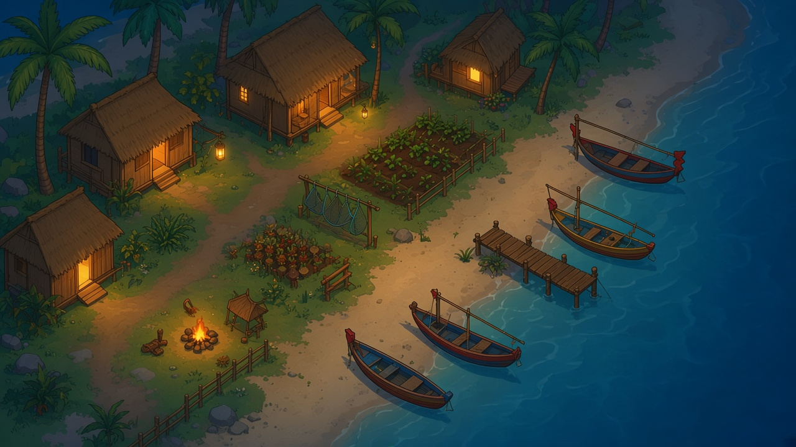

# Design review: a simpler 2D agent simulation ("Village Sim")

Status: **proposal for discussion. No code has been written.**

This document proposes a new, smaller agent simulation that keeps the core idea of
thehabitat's `reverie` simulation (agents that live, remember and act on their own in a 2D
world) but with a much simpler design. It is a design review only. Nothing here changes the
existing `reverie` backend or the Django frontend.

## 1. Simulation concept

- A small waterside fishing village at night. Boats are moored along the shore, with a few
  huts, a jetty, a garden plot and a path along the water.
- A handful of agents (start with 3 to 5) live in the village. Each has a name, a short
  persona, a home, a daily routine and a few relationships.
- Agents move around a 2D grid, do simple activities (fish, mend nets, tend the garden,
  talk, rest) and can talk to nearby agents.
- Time advances in discrete steps (for example one step is 10 game minutes).
- The point of the project is to watch believable, mostly self-directed behaviour emerge,
  not to simulate a detailed world.

Art: the project's own background is an original, newly generated night scene of a waterside
village with boats along the shore (`docs/assets/village-night-background.jpg`). A game
screenshot was used only as a mood and style reference. It is not used or included in the repo.



## 2. Architecture

The key rule is that **agent logic and rendering never import each other**. They talk only
through a small, serializable world state.

```
+--------------------+      world state (JSON)       +--------------------+
|  Simulation core   |  ---------------------------> |  Renderer / UI     |
|  (agents, world,   |                               |  (background image |
|   clock, memory)   |  <--------------------------- |   + sprites)       |
+--------------------+   optional user commands      +--------------------+
          |
          v
   LLM provider (pluggable, can be mocked)
```

Proposed layers:

1. **World layer.** Grid size, walkable/blocked tiles, named places (home, jetty, garden)
   and objects with a state. Loaded from one JSON file.
2. **Agent layer.** Persona, position, current activity, a short memory list and a plan
   for the day. Pure Python with no web or drawing code.
3. **Decision layer.** One function, roughly `decide(agent, observation) -> action`. It
   can be rule-based, LLM-based or a mix. It must be replaceable and mockable so the
   simulation runs and is testable with no API key.
4. **Clock and runner.** Advances one step at a time, applies actions, and writes a state
   snapshot per step.
5. **Renderer.** Reads snapshots only. It can be a web page or a desktop viewer and it
   can even replay a recorded run.

Data contract between core and renderer (sketch, to be finalised):

```json
{
  "step": 42,
  "time": "21:20",
  "agents": [
    {"id": "mara", "x": 12, "y": 7, "activity": "mending nets", "speech": null}
  ],
  "events": ["mara greeted tom"]
}
```

Because the renderer only reads this file or stream, the core can run headless and fast,
and the renderer can be swapped without touching agent code.

## 3. Graphics approach

- **Background:** a static image of the village (or a lightly animated one: water shimmer,
  boat bobbing, lamp flicker via a few looping frames or simple shader-free tweens).
- **World to pixels:** an invisible tile grid laid over the background. Walkable tiles are
  hand-marked once (a JSON mask or a small tilemap editor export), so agents never need to
  understand the image itself.
- **Agents:** small sprites (or even coloured markers at first) moved between tiles, with
  an optional speech bubble and name label.
- **Cost:** no 3D, no physics, no per-frame heavy work. One background plus a few sprites
  is trivial for any browser or phone. Rendering is the cheap part.
- **Where the complexity lives:** agent logic, that is memory, planning, conversation and
  keeping behaviour believable over many steps. Budget design and testing time there, not
  on graphics.
- Upgrade path if wanted later: parallax layers, day/night tint, tile-based terrain
  instead of one flat image.

## 4. What to strip from the reverie design

Reverie is powerful but heavy. For the new project, propose to drop or simplify:

- **Full memory stream with embeddings and retrieval scoring.** Start with a short
  fixed-size list of recent events plus a few stored facts. Add retrieval only if needed.
- **Multi-level spatial memory and path-finding tied to a large Tiled map.** Use one small
  grid, a handful of named places, and plain A* or even straight-line moves.
- **Hierarchical daily planning with many LLM calls per step.** Use a day plan generated
  once (or a fixed schedule template) and call the model only when something interesting
  happens (meeting another agent, a conflict, a new event).
- **Reflection and relationship-update prompts.** Make these optional and run them rarely,
  for example once per game day.
- **Two cooperating servers sharing JSON files in several storage folders.** Use one
  process for the core and an optional separate viewer fed by a single snapshot file or
  stream.
- **Interactive stdin command loop and global config in a Python module.** Use a plain
  config file and a simple CLI with arguments.
- **Heavy per-step prompting costs.** Cap model calls per step and cache decisions.

Keep from reverie: the idea of persona plus memory plus plan, the discrete step clock,
JSON snapshots that can be replayed, and the practice of running with different model
providers.

## 5. Reuse target: reverie's agent behavior pipeline

The new village sim should reuse the shape of reverie's per-agent behavior pipeline for its
core logic, simplified as described in section 4. All paths below are under
`reverie/backend_server/`.

### 5.1 Main loop

`ReverieServer.start_server` in `reverie.py` is the main loop. Each step it:

1. waits for the frontend's environment file for the current step,
2. moves every persona to the tile the frontend reported,
3. calls `persona.move(...)` for each persona,
4. writes all movements to a movement file for the frontend,
5. advances the clock by `sec_per_step`.

### 5.2 Per-agent cognitive sequence

`Persona.move` in `persona/persona.py` sets the current tile, works out whether it is a first
day or a new day, then runs these in order:

`perceive` -> `retrieve` -> `plan` -> `reflect` -> `execute`

It returns the next tile, an emoji, and a description of the action.

### 5.3 Inputs to an agent's next action

- **Environment state.** `perceive` looks at nearby tiles in the maze for events and objects.
  Each one is scored for importance by the LLM (`generate_poig_score`).
- **Memory.** `retrieve` (`new_retrieve`) pulls relevant memories from the associative memory
  using recency, importance and embedding similarity.
- **Scratch memory.** The working state: identity, daily plan, schedule, current action,
  path, and chat state.
- **LLM prompts.** `plan.py` calls the prompt functions in `persona/prompt_template/run_gpt_prompt.py`,
  which go through `gpt_structure.py` and `api_router.py` to the model.

### 5.4 Plan

- On a new day, `_long_term_planning` generates the wake-up hour, the daily plan and the
  hourly schedule.
- When the current action finishes, `_determine_action` decomposes the next task and picks
  the place, the object, an emoji and the event triple.
- `_should_react` then decides whether to talk or wait. Chatting goes through `_chat_react`
  and `generate_convo`.

### 5.5 Reflect

`reflect.py` checks `reflection_trigger`, which fires when accumulated importance runs out.
`run_reflect` then generates focal points and insights and stores them as new memories.

### 5.6 Execute

`execute.py` is **not** LLM-based. `path_finder` turns the plan's place address into a tile
path, and `execute` returns the next tile on it. This is the cheap part and a natural fit for
the village sim's simple grid.

### 5.7 Key files

- `reverie.py`
- `persona/persona.py`
- the six modules in `persona/cognitive_modules/`: `perceive.py`, `retrieve.py`, `plan.py`,
  `execute.py`, `reflect.py`, `converse.py`
- `persona/memory_structures/`: `associative_memory.py`, `scratch.py`, `spatial_memory.py`
- `persona/prompt_template/`: `run_gpt_prompt.py`, `gpt_structure.py`, `api_router.py`

### 5.8 How the village sim maps onto it

| Reverie piece | Village sim plan |
| --- | --- |
| `start_server` loop and env/movement files | One runner that writes a snapshot per step |
| `Persona.move` sequence | Keep the same order, as a replaceable `decide` function |
| `perceive` / `retrieve` | Nearby events plus a short rolling memory |
| `plan` (`_long_term_planning`, `_determine_action`, `_should_react`) | Once-a-day plan, model call only on interesting events |
| `reflect` | Optional, once per game day |
| `execute` and `path_finder` | Plain pathing on one small grid |

## 6. Open questions

1. **Art direction (resolved for now).** The village background is an original generated image
   (see section 1), not the reference screenshot. Still open: keep generating art, commission an
   artist, or add sprites and tiles in the same style. Confirm the generated image's licence terms
   before any commercial use.
2. **Platform.** Browser (canvas or Phaser-style) or a native viewer? Does it need to
   run on a phone?
3. **Reuse or standalone.** Should this live inside thehabitat (new folder) or in its own
   repository so it does not entangle with the reverie stack and its Docker setup?
4. **Model provider.** Which LLM provider and model, what per-step budget, and is a
   fully offline rule-based mode a hard requirement?
5. **Agent count and step size.** How many agents, and how long is one step in game time?
6. **Memory depth.** Is a short rolling memory enough, or do we want long-term recall
   across many game days from the start?
7. **Player role.** Pure observer, or can the user talk to agents and drop events in
   (a storm, a festival)?
8. **Persistence and replay.** Is saving runs and replaying them in the viewer a v1
   feature?
9. **Language and stack.** Python core as in reverie, or another language?
10. **Success criteria.** What does a good first demo look like (for example five agents
    running a full game day without human input)?

## Suggested next step

Decide questions 1 to 4, then write a one-page technical spec for the world file and the
snapshot format. Only after that start implementation.
